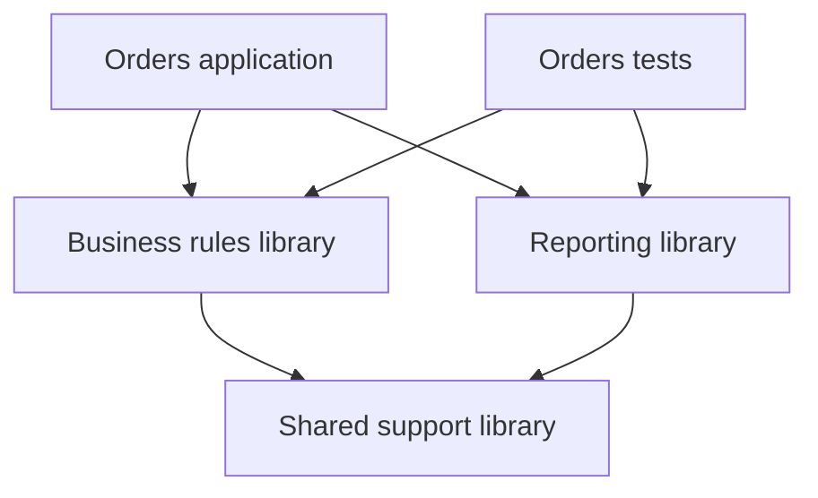

# Building HarbourNova applications: hnmake, projects, and editor integration

**Developer overview of the HN1 build toolset and the Visual Studio Code/VSCodium development workflow — November 10, 2026**

> **Scope:** This article explains HarbourNova's project and build model, the role of `hnmake`, and the development experience shared by the command line, Visual Studio Code, and VSCodium. It covers graphical project editing, build controls, running, debugging, optional linting, profiling, reusable components, and application resources.

An application needs more than a compiler invocation. Its build must select the right source files, follow dependencies, apply the intended options, include libraries and resources, and produce the correct program for the selected platform. The developer then needs to run that program, understand errors, inspect its behavior, and prepare it for distribution.

As applications grow, these choices can become scattered across scripts, editor settings, and knowledge that only one developer remembers. A build may work from one terminal but behave differently inside an editor. A Debug session may accidentally start an older executable. A shared library may be compiled with settings that do not match the application using it.

HarbourNova brings these activities together through **`hnmake` and a common HN project model**. The project describes the application. A target identifies what to build. A profile selects the platform, toolchain, and configuration. The same definitions drive command-line builds and the HarbourNova extension for **Visual Studio Code and VSCodium**, including its graphical Project Editor, searchable project tree, build options, and action buttons.

The result is a development workflow in which project configuration, compiler knowledge, build results, and editor actions remain connected.

## The parts of the toolset

Each part has a distinct responsibility:

| Part | Responsibility |
| --- | --- |
| **`hnmake`** | Reads projects and workspaces, resolves inputs and dependencies, plans and executes builds, manages reusable build results, and coordinates running and testing. |
| **HN compiler** | Understands HN source and its language contracts, checks declarations and calls, and generates the code and semantic information needed by the build. |
| **Native toolchain** | Compiles generated and handwritten C, creates native libraries, and links the platform's executable. |
| **HN runtime** | Supplies the runtime behavior used by the resulting HN application. |
| **HN project and workspace files** | Record the source selections, targets, profiles, dependencies, resources, and relevant execution settings. |
| **HarbourNova editor extension** | Presents a graphical Project Editor, project navigation, build controls, language assistance, diagnostics, debugging, and profiling reports within VS Code or VSCodium. |
| **HNConvert** | Helps migrate supported legacy source and project definitions into the HN model, with explicit conversion results and unresolved items. |

`hnmake` is a native build tool written in Rust. Its public command is `hnmake`, and it coordinates the HN compiler and native tools. An application developer continues to write HN; the build tool's implementation language does not change the application's source language.

An installed HN toolset provides the build components needed for ordinary HN development. The selected native compiler, linker, and platform development files must also be available. Ordinary `hnmake` execution does not require a Python interpreter or GNU Make. Building the HN toolset itself from source additionally requires its Rust and native C build prerequisites.

The editor is a convenient way to work with these tools. The command-line interface remains independently useful for terminal work, scripts, test runs, and automated builds.

## One project definition for the terminal and editor

HN uses readable UTF-8 JSON files as its project definitions:

| File | Meaning |
| --- | --- |
| `*.hnproject.json` | One project's sources, targets, profiles, dependencies, resources, and execution settings. |
| `*.hnworkspace.json` | A collection of explicitly identified projects and their build relationships. |
| `*.hnp` | HN program source. |
| `*.hnh` | HN include or header source. |

For example, an application can use `Orders.hnproject.json`, while a collection containing that application and its supporting libraries can use `BusinessApplications.hnworkspace.json`.

These files belong with the source in version control. A reviewer can see a change to a compiler option, source selection, or resource placement alongside the code that depends on it. Team members can use the same definition from different editors and from automated environments.

Developers can maintain these definitions through the graphical Project Editor's forms, selectors, switches, and property panels. Editing a target through a form changes the JSON project definition, with normal save, undo, redo, validation, and diff review. Direct JSON editing remains available for developers who prefer it. External changes are handled as document changes, so an old editor view cannot silently overwrite a newer project definition.

Generated build plans, caches, and result reports have different roles. They describe work derived from a project and the inputs used for a particular build. The project file remains the place to change what the application is supposed to contain.

Project formats are versioned. A format upgrade is an explicit, reviewable change; opening a project does not silently rewrite it into a different schema.

## Projects, targets, configurations, and profiles

These terms describe different choices:

| Concept | Question it answers | Example |
| --- | --- | --- |
| **Project** | Which related sources and build definitions belong together? | The Orders application. |
| **Fileset** | Which files participate in a particular part of the project? | HN files beneath `src/`, excluding experiments. |
| **Target** | What should this build produce or do? | An order-report executable or its test program. |
| **Configuration** | How should the code be built? | Debug symbols, optimization, warnings, and compile-time definitions. |
| **Toolchain** | Which compiler, linker, and library tools should perform the build? | The selected HN compiler together with GCC or MSVC64. |
| **Profile** | Which platform, toolchain, and configuration should be used together? | Linux x64, GCC, Debug. |
| **Workspace** | Which projects and targets participate in the larger build? | Orders, shared business rules, and application tests. |

A project can contain several targets. The same application target can have Debug and Release profiles. A test target can share application code while providing its own entry point and expected results.

Profiles keep meaningful combinations together. Selecting a profile changes the build context: the compiler and native tools, relevant options, include locations, definitions, output ownership, and dependency configuration. The editor uses that context for its project actions and language assistance.

Explicit selection takes precedence over project defaults. If the choice is ambiguous, HN reports the available choices. Discovering a compiler on the machine does not silently replace the profile the developer selected.

### Source selections stay understandable

A fileset gives a name to a file selection. It can include a directory tree and exclude specific patterns, allowing a project to grow without manually repeating every source filename. The resolved list is deterministic and can be inspected.

HN program files use `.hnp`. Headers use `.hnh` and participate through include dependencies; a header does not become an independently compiled program merely because it exists in the source tree. Handwritten C can participate in the same build through its declared source inputs.

Project paths are resolved according to the document and its declared root. Their meaning does not depend on whichever directory happened to be active when a command was started. Canonical project paths use `/` separators on both Windows and Linux.

This also makes ordinary maintenance errors easier to identify. A required fileset that resolves to no files, a missing dependency, or two inputs competing for the same output can be reported as a project problem before native linking begins.

## A first everyday workflow

Consider an Orders project with the following declarations:

| Item | Example project-defined name |
| --- | --- |
| Project document | `Orders.hnproject.json` |
| Application target | `orders_app` |
| Test target | `orders_tests` |
| Linux Debug profile | `linux-gcc-debug` |
| Linux Release profile | `linux-gcc-release` |
| Windows Debug profile | `win-msvc64-debug` |

These target and profile names are examples declared by this project. They are not predefined names that every HN project must use.

From a terminal, a developer can validate the project and build the application:

```sh
hnmake validate --project Orders.hnproject.json
hnmake build --project Orders.hnproject.json --target orders_app --profile linux-gcc-debug
```

The build selects `orders_app` and resolves it using the project's Linux/GCC Debug profile. It determines which sources and dependencies belong to that selection, checks whether existing work can be reused, and produces the corresponding executable.

To build and run the selected application:

```sh
hnmake run --project Orders.hnproject.json --target orders_app --profile linux-gcc-debug
```

`run` builds the current selection by default, then runs its verified result. The project's execution settings provide the normal arguments, working directory, and environment.

Arguments following `--` are passed to the application as an explicit replacement for its declared argument list. For example, if this application accepts `--customer`:

```sh
hnmake run --project Orders.hnproject.json --target orders_app --profile linux-gcc-debug -- --customer 42
```

The equivalent Windows build selects the Windows profile:

```sh
hnmake build --project Orders.hnproject.json --target orders_app --profile win-msvc64-debug
```

The application remains the same project. Its native output and toolchain follow the selected platform. The appropriate host tools and platform development environment must be available for that profile.

If a project declares unambiguous default targets and a default profile, the everyday command can be shorter:

```sh
hnmake build --project Orders.hnproject.json
```

The longer form is useful in scripts and documentation because it makes the intended selection visible.

## What happens during a build

`hnmake` coordinates several related operations:

1. **Resolve the selected project context.** Read the project, target, profile, filesets, dependencies, resources, and tool selections.
2. **Resolve declarations and dependencies.** Use the HN compiler's knowledge of source, includes, callable contracts, and classes to establish the required relationships.
3. **Reuse or compile the affected work.** Generate C for HN units that need compilation and compile the required generated or handwritten native sources.
4. **Check the complete application before linking.** Verify that the compiled pieces satisfy the callable, class, module, and resource requirements of the selected target.
5. **Create the final products.** Link the executable or create the appropriate library, prepare its resources, and record the resulting artifacts.

These operations give HN a build model that understands language contracts as well as files. A function body and its public calling contract have different effects on dependent code. The builder can use that distinction when deciding what must be compiled again.

Checks before linking also help prevent incompatible pieces from being combined. For example, a caller compiled against an older function signature cannot be accepted simply because a native object file still exists. Class declarations and separately defined method bodies must agree. Required resources must be supplied by the application's resource configuration.

The build result identifies the actual output for the selected target and profile. Editor run and debug actions use that result, keeping the launched program connected to the build that produced it.

## Incremental builds: reuse work for a reason

Incremental building matters most during repeated edit, build, and test cycles. HN distinguishes changes by the work they affect:

| Change | Build consequence |
| --- | --- |
| No relevant change | Reuse the corresponding compiled work and final output. |
| A function body changes | Compile the affected unit and native object; callers can remain reusable when their required contracts are unchanged. |
| A function's calling contract changes | Recheck and recompile affected callers. |
| A class contract or layout changes | Rebuild the dependent implementations and other affected compiled work. |
| An included header changes | Re-evaluate sources affected by the compiler-observed include relationships. |
| Embedded resource contents change | Repack and relink the affected resource products while retaining unrelated HN compilation. |
| Compiler, native tools, or relevant build options change | Re-evaluate cached work against the new build context. |

The practical benefit is less repeated work without treating every existing object file as trustworthy. Source selections, compiler identities, options, dependency contracts, and resources all contribute to the reuse decision.

Developers can inspect those decisions:

```sh
hnmake explain --project Orders.hnproject.json --target orders_app --profile linux-gcc-debug
```

`explain` helps answer why a unit needs compilation, why the program needs relinking, or why an existing result can be reused. `plan` shows the intended actions, while `list` exposes the resolved selection and inputs.

For stronger input verification, `--verified` checks content even when a file's size and timestamp have been preserved:

```sh
hnmake build --project Orders.hnproject.json --target orders_app --profile linux-gcc-release --verified
```

Normal incremental checking and verified checking serve different cost and assurance needs. Neither changes the application's language rules.

### Rebuild, clean, and cancellation

`rebuild` forces rebuilding the selected owned target. `clean` removes verified build-owned products. Output ownership matters: selecting Clean is not permission to delete unrelated source or arbitrary files in a directory, and altered or unowned outputs can require explicit attention.

Cancellation applies to the build operation and its child tools. A cancelled or failed attempt does not become a successful result, and an older executable is not silently substituted for the program the developer just tried to build.

## Windows and Linux use the same model

HN1's native build environments include Linux x64 with GCC and Windows x64 with MSVC64. Both use the same HN project concepts and command structure.

| Native build environment | Typical native products |
| --- | --- |
| Linux x64 / GCC | Executable, `.a` static library, and C-only `.so` shared library. |
| Windows x64 / MSVC64 | `.exe`, `.lib` static library, and C-only DLL with its import library. |

A profile records the platform-specific choices. Project-relative source paths and common application definitions can remain shared, while the selected tools, system libraries, output naming, and relevant options differ.

This is source and project portability. Each native output belongs to its target operating system and compatible runtime environment. Platform-specific APIs and external dependencies still require the appropriate application design and build configuration.

The editor interface and the machine executing the tools are separate concerns. HN build and language-service work belongs on the host containing the workspace and selected HN installation. When a compatible remote workspace is used, those operations belong to that workspace host. A local editor window does not, by itself, determine where compilation runs.

## Working in Visual Studio Code or VSCodium

HarbourNova uses one extension design for both editors, including the same project model, language services, and debugger. Developers can choose the editor they prefer while retaining the same HN project files and build behavior.

[Visual Studio Code](https://code.visualstudio.com/) is Microsoft's editor distribution. [VSCodium](https://vscodium.com/) provides community-built, freely licensed binaries from the VS Code source. HN's core editor functionality does not require a Microsoft account, a proprietary Microsoft extension, or a particular extension marketplace.

The HarbourNova extension is distributed as a VSIX package. Direct VSIX installation provides a common installation route for both editors. Their general extension catalogs differ: VS Code uses the Visual Studio Marketplace, while VSCodium uses Open VSX by default. See the official [VS Code VSIX installation instructions](https://code.visualstudio.com/docs/configure/extensions/extension-marketplace#_install-from-a-vsix) and [VSCodium extension documentation](https://github.com/VSCodium/vscodium/blob/master/docs/extensions.md).

HN uses familiar editor areas:

| Editor area | HN use |
| --- | --- |
| **HarbourNova Projects** | Search and navigate projects, targets, profiles, sources, resources, and dependencies, with the current selection and build status visible. |
| **Buttons, context menus, Command Palette, and Tasks** | Invoke build, rebuild, clean, test, run, and debug actions for the selected project context through the appropriate editor surface. |
| **Task terminal** | Show build output, progress, and cancellation. |
| **Problems** | Present build and compiler diagnostics with source navigation. |
| **Run and Debug** | Launch an HN application or attach to a compatible running HN process. |
| **API Explorer** | Browse HN API information, signatures, details, and examples. |
| **HN Project Editor** | Use HN Web Foundation controls to edit source selections, profiles, targets, dependencies, resources, outputs, and execution settings through the canonical project document. |

The editor checks the selected HN installation and its compatibility. This keeps project operations and semantic information associated with the intended toolchain, including when a developer maintains more than one HN installation.

## Visual project management and build controls

HN's graphical development experience combines an integrated project explorer with a richer Project Editor. Both use the same project model and selected hnmake installation.

### A searchable project explorer

**HarbourNova Projects** uses the editor's native Tree View for everyday navigation. Its hierarchy exposes workspaces, projects, targets, profiles, source selections, resources, and dependencies, together with relevant build, run, and debug status.

Search and filtering help locate a project item without repeatedly expanding a large hierarchy. For example, a developer can find a resource by name, locate the profile used by a particular target, or inspect a library dependency. The selected project, target, and profile remain visible so subsequent actions have a clear context.

Native editor commands, project context menus, selection dialogs, and action buttons provide convenient access to the corresponding operations. They use the same execution and diagnostic paths as other HN editor commands.

### The graphical HN Project Editor

The richer **HN Project Editor** runs inside VS Code or VSCodium as an embedded web panel, called a *webview*. Its default UI toolkit is **HN Web Foundation**, using the framework's reusable Web Components and supporting styles and runtime.

The editor combines searchable trees with forms and property panels. Text fields, selectors, checkboxes or switches, multi-value controls, reorderable lists, dialogs, and action bars provide suitable ways to maintain different kinds of project information.

| Project area | What the graphical controls let the developer manage |
| --- | --- |
| **Sources and filesets** | Source folders, include/exclude patterns, and the inputs selected for a target. |
| **Targets** | Output kind, source selections, include locations, definitions, and applicable compiler/linker options. |
| **Configurations and profiles** | Platform and toolchain selections, Debug/Release settings, symbols, optimization, and warnings. |
| **Dependencies** | Relationships between targets, libraries, and projects. |
| **Resources** | File selection, virtual folders, and placement in the executable, companion pack, or external output. |
| **Outputs** | Target output names and locations. |
| **Run and test settings** | Application arguments, working directory, environment, and declared test expectations. |

Within this richer panel, the HN Web TreeView component provides reusable hierarchical interaction alongside the associated editing controls. It has a separate role from the native project explorer: one belongs to the web-based Project Editor, while the other integrates project navigation with the surrounding editor.

HN Web Foundation supplies general-purpose components; the HarbourNova extension supplies the project-specific layout, bindings, and actions. A generally useful component enhancement belongs in the shared framework so other HN Web consumers can benefit from it.

The framework assets are bundled with the extension at a defined version. The graphical editor can operate locally and offline, with its behavior tied to the installed toolset.

### Build options and action buttons

A developer can select the current target and profile, adjust its settings visually, save the changes, and invoke the appropriate build action. Common actions are exposed through suitable buttons, action bars, context menus, and standard editor controls:

| Action | Effect |
| --- | --- |
| **Build** | Incrementally build the selected target and profile. |
| **Rebuild** | Force the selected target's owned build work to be rebuilt. |
| **Clean** | Remove verified build-owned products. |
| **Test** | Build and execute the selected test target. |
| **Run** | Execute the current successful build using its declared execution settings. |
| **Debug** | Launch the selected application or use an explicit attach configuration. |
| **Cancel build** | Request cancellation of the active build and its child tools. |

For example, a developer can select the Orders application, choose its Release profile, change a resource set's placement to the companion pack, save, and press Build. The graphical changes update the same project definition used by a subsequent command-line build.

The result is a visual way to manage the complete build configuration while retaining readable files, source-control review, and scriptable builds. The buttons invoke the shared tools; the forms edit the shared definitions.

### Selecting and building a project

A typical editor session follows these steps:

1. Open the application folder and select the HN installation for that workspace host.
2. Open **HarbourNova Projects** and refresh discovery when needed.
3. Choose **HarbourNova: Select Project, Target and Profile**.
4. Select the application target and its Debug or Release profile.
5. Save the relevant source and project changes.
6. Run **HarbourNova: Build Current Project, Target and Profile**.

Selection and execution are separate actions. Choosing a profile changes the context for subsequent work. Build compiles that selection. Running or debugging the application is another explicit action.

This distinction is useful for both desktop and server applications. A developer may need to build a program that another process starts, or prepare a new executable for a later test without immediately launching it.

### Diagnostics take you to the relevant source

Build diagnostics carry their severity, origin, message, and available source location. The Problems view can navigate to the HN source or included file responsible for a diagnostic. Related locations can explain a conflict involving more than one declaration.

A diagnostic with only a line number is presented as a line-level location. If a tool supplies no source location, its message remains useful in the build output. The editor does not invent a precise token range from incomplete information.

The command line and editor consume the same build outcome. A visually successful task entry cannot override a compiler or linker failure.

## Run the program you actually built

HN connects execution to the selected build result. The executable's identity, profile, arguments, working directory, and relevant environment come from the project and successful build.

This is especially useful when a workspace contains several applications or when Debug and Release outputs coexist. The currently open source file does not determine which executable to start. The selected project and target do.

If sources or required products have changed, a retained result must be checked again before execution. A failed build cannot quietly launch the preceding successful program and make it appear that the edited code is running.

The CLI's ordinary `run` command includes building. The editor's explicit Run actions use the current successful build for the selected context and require another build when that result is stale.

### Captured output and interactive terminals

The editor provides two useful run modes:

| Run mode | Suitable use |
| --- | --- |
| **Run Selected Project (Captured Output)** | A report generator, utility, or other non-interactive program whose output should be collected by the tool. Application standard input is closed. |
| **Run Selected Project in Terminal (Interactive)** | A console program that needs keyboard input. It runs in a real terminal, with input belonging to the application. |

Both modes use the selected project's execution settings. Their difference is how the application interacts with its console, rather than which project definition controls the build.

## Debugging HN source

The HN debugger integrates with the editor's Run and Debug interface. A target built with a Debug profile includes the appropriate compiler debug settings and compatible HN debugger support as explicit build inputs.

The normal debugging workflow includes breakpoints, stepping, continuing execution, viewing the call stack and local variables, inspecting Watch expressions, and navigating back to source. Expression evaluation follows the debugger's supported expression rules.

The debugger and build tool retain distinct responsibilities. `hnmake` establishes the selected program and its build context. The debugger examines the execution of that program.

### Launch and attach solve different problems

| Debug operation | What it does |
| --- | --- |
| **Launch** | Starts the selected, verified application under the HN debugging workflow. |
| **Attach** | Connects to an already running, compatible HN process using its explicit process ID and matching source information. |

Launch is convenient when the developer controls application startup. Attach is useful when another system starts the program, such as a server or a separate application launcher.

For example, a developer working on a server-managed HN application can build the application with its Debug profile, arrange for the server to use that executable, and then attach to the running HN process. Attaching does not rebuild or start the process; it requires that the process already contain the necessary HN debug support.

Process ownership also determines how a session ends. Stopping a tool-owned launch ends its supervised run. An ordinary disconnect from an attached process detaches and allows that process to continue. Explicit termination is a separate choice when the attached target must be stopped.

### Source and executable stay connected

A useful Debug session needs the executable and source to describe the same program. HN retains the build context and artifact information needed to check that relationship. Editing a file does not change the executable that is already running; the normal cycle remains save, build, and start the appropriate new session.

This makes it easier to answer a basic but important question during debugging: which version of the application is being examined?

## Language assistance follows HN's language rules

Syntax coloring is useful, but reliable assistance also needs to understand what a name means in the selected project.

HN's editor design connects language services to the compiler and the toolchain's API and type information. Built-in HN APIs use their cataloged contracts. Application functions, classes, methods, and constructors use the declarations and relationships understood by the HN compiler.

This supports assistance that reflects the actual call:

- Completion and navigation follow the symbol's visibility and scope.
- Signature help understands positional and named arguments.
- Parameter information includes external names, types, reference behavior, required arguments, and defaults.
- Class information includes constructors, inherited members, and method implementations stored in separate source files.
- API browsing can connect a callable's signature to its documentation and examples.

For example, when a function accepts several named parameters, signature help can account for the names already supplied and the argument being edited. Nested calls and expressions containing commas are interpreted through the language's call structure.

Optional typing remains part of HN's programming model. For a local variable, datatype-specific native-method completion and validation require an explicitly declared concrete datatype. The editor does not infer that datatype from assignments, constructors, naming conventions, or control flow. Untyped locals retain general syntax assistance without speculative native-member suggestions. An `Any` declaration also does not identify a concrete native member set. Explicit parameter, return, and property contracts supply their own type information.

### Editing a buffer and building an executable are different activities

Language assistance can examine current unsaved source, including an incomplete expression being typed. It uses the selected project's context without requiring a full native build after every edit.

When a declaration is incomplete, the editor can present the information that is safely available. Responses from an older document version or a previous project selection are discarded so that they do not replace newer information.

A normal build uses saved source and project files. Analysis of an unsaved buffer does not replace the last successful executable or make that buffer part of a program already running. Likewise, an inspection of a previous build describes that build; it is separate from analysis of the current editor contents.

## Optional linting supports project conventions

HN provides optional linting for developers and teams that want additional checks alongside normal compilation. Selected rules can reuse supported compiler checks, apply HN policy checks, or express bounded declarative project rules. Examples include unused-variable checks, naming conventions, and restrictions on particular resolved calls or dependencies.

Rules can be configured individually. A project can use advisory findings or an enforced severity threshold, and the editor presents findings through Problems with their source locations. The team's policy belongs in version-controlled configuration, while the editor supplies a convenient way to review and adjust it.

Linting is optional; language validity remains a compiler responsibility. Disabling lint does not disable syntax errors or mandatory semantic and type checks. Lint findings also do not automatically modify the application's source.

The incremental behavior is deliberate. During an ordinary build with lint enabled, current rules apply to source units that are actually compiled. Changing a rule alone does not force unchanged source to be rebuilt or reanalyzed. Retained findings keep their original policy identity, and the editor distinguishes current results from older or unchecked coverage.

**Recompile All with Lint** explicitly applies the current enabled rules across the applicable HN source and targets in the project's selected configuration. It provides a full review of that declared scope when a team wants to adopt a revised policy throughout the project.

## Several projects can form one application system

A larger application often contains a main executable, reusable business logic, reporting code, and test programs. An HN workspace records those projects and their dependencies explicitly.

Consider a workspace in which the application and its tests use the same business and reporting libraries. Both libraries depend on shared support code:



The arrows mean “depends on.” HN builds prerequisites in dependency order and builds a shared prerequisite once within the selected build. A missing dependency or cycle produces a diagnostic identifying the relationship that needs correction.

A workspace can map one workspace profile to the corresponding profiles in its member projects. This keeps a Debug application and its dependencies in a compatible build context. Toolchain and runtime compatibility are checked across the selected dependency set.

An **aggregate target** groups other targets. It can represent a goal such as building the application and tests together while producing no executable of its own. A dependency failure prevents its dependents from being treated as successfully built.

The HN workspace has a build-system meaning. An editor's folder arrangement or `.code-workspace` file can organize the editing session, while `.hnworkspace.json` records the HN project relationships used by both the editor and CLI.

### Libraries remain explicit build products

HN supports reusable HN/C static libraries with their native archive products and the semantic information needed by consumers. The final application checks the contracts and required members of those libraries before linking them.

C-only shared-library targets provide native integration through explicit exported C symbols. Their platform ABI and deployed runtime files are part of the contract. This is a bounded native-library facility; dynamically loaded HN modules have their own language and runtime contracts.

### Generated sources participate in dependencies

Some projects generate source from schemas, definitions, or other input files. HN represents such work as a declared tool action with explicit inputs, outputs, arguments, working directory, and environment.

The generated files then participate in the same project context as other HN, C, or header inputs. Changing the generator or its inputs can require regeneration. If regeneration produces identical bytes, downstream compilation can retain reusable work.

This keeps generated code connected to the inputs that explain it and avoids relying on an undocumented manual step before each build.

## Application resources belong in the project

An application may need HTML, CSS, images, SQL text, report templates, lookup data, or other files alongside its executable code. HN lets the project describe those inputs and choose where each resource set belongs.

A resource set can contain a single file or a group selected by include and exclude rules. It supplies a virtual root and a storage disposition:

| Disposition | Purpose |
| --- | --- |
| **`embedded`** | Place the selected resource data inside the main executable. |
| **`pack`** | Place it in the executable's single companion `.hnres` file. |
| **`external`** | Deploy the selected files as loose external files. |
| **`build_input`** | Make the files build dependencies without treating them as packaged application resources. |

The target explicitly selects the resource sets it uses. Their names and placement become part of the application's build definition.

### One virtual namespace across the executable and companion pack

Embedded resources and companion resources share the application's **`res:/`** namespace. A file's virtual path can stay the same when its physical placement changes.

For example, this is a `resource_sets` array fragment for a project using `hnmake.project.v4` with `schema_version: 4`:

```json
[
  {
    "id": "web_logo",
    "base": "assets",
    "include": ["logo.svg"],
    "virtual_root": "res:/web/",
    "disposition": "embedded",
    "compression": "none"
  },
  {
    "id": "reference_data",
    "base": "assets",
    "include": ["reference-data.bin"],
    "virtual_root": "res:/web/",
    "disposition": "pack",
    "compression": "none"
  }
]
```

The target selects both sets through its `resources` field:

```json
"resources": ["web_logo", "reference_data"]
```

These are fragments of a project definition, not a complete project file. The resulting virtual paths are `res:/web/logo.svg` and `res:/web/reference-data.bin`. They share a virtual folder even though one file is inside the executable and the other is in its companion.

Changing the logo's disposition to `pack` preserves `res:/web/logo.svg`. Application code continues to use that resource path. Duplicate virtual filenames and case collisions across the two destinations are diagnosed during the build.

### The executable's resource allowance

The combined original payload of all resources embedded in one executable has a maximum of **500 MiB (524,288,000 bytes)**.

This is one allowance across all selected embedded sets. A single file can use the entire allowance. There is no separate smaller per-file or per-set limit within that allowance.

Executable code, resource indexes, headers, and alignment contribute separately to the actual executable size. Consequently, 500 MiB of embedded file payload does not mean that the complete executable is limited to 500 MiB.

If the selected payload exceeds the allowance, the build identifies the problem. The developer can explicitly move suitable resources to the companion pack; the builder does not silently change their configured placement.

### Larger resources use one companion pack

All resource sets assigned to `pack` share **one companion file per executable target**. Companion bytes are outside the executable's 500 MiB embedded-payload allowance.

The pack uses 64-bit offsets and lengths and supports bounded reads of individual entries larger than 2 GiB. Its practical maximum depends on the supported filesystem and build/runtime limits; the design does not assign it a universal numeric size ceiling.

The companion uses the executable's basename:

| Executable | Companion |
| --- | --- |
| Windows `Orders.exe` | `Orders.hnres` |
| Linux `Orders` | `Orders.hnres` |

The companion is located beside the actual executable, independently of the process's working directory. Deploy the matching executable and companion together; if they are renamed, retain the matching basename. An application with no selected pack entries needs no companion file.

### Resource access and deployment remain predictable

Packaged resources are read-only application data. HN verifies the expected resources before exposing them to the application, and a required missing or incorrect companion is an application-startup error.

Resource handles permit reading parts of a large entry without requesting the entire entry as one application value. Reading a whole entry still requires memory for that result. Resource verification also reads the packaged data, so very large collections have a startup cost that should be considered when choosing an application's packaging.

Virtual resource access is provided through HN's resource-aware file interfaces. An external library that requires an ordinary operating-system pathname can use an explicitly materialized file. Such a pathname requirement remains separate from the application's stable `res:/` resource name.

## Testing uses the same project context

Test programs are declared targets with the same source, profile, dependency, and resource rules as application targets.

For the example Orders project:

```sh
hnmake test --project Orders.hnproject.json --target orders_tests --profile linux-gcc-debug
```

The test action builds the selected test executable and runs it with its declared arguments, working directory, and environment. It can check an expected exit status and declared output expectations. The result preserves the program's actual outcome and diagnostic information.

Keeping tests in the project model makes them easier to repeat from the terminal, editor, or build automation. A shared library dependency is selected in the same explicit way, and the test cannot silently inherit a different profile just because it was started from a different interface.

Application assertions and test harnesses still define what behavior is correct. The build tool coordinates their construction and execution and reports the outcome.

## Profiling explains where execution time goes

Debugging helps explain program behavior. Profiling measures where time is spent and how frequently code runs.

HN's profiler is an explicit build selection, independent of Debug and Release. An optimized Release application can be built with profiling enabled. Profiling is off by default, and a build with profiling disabled omits profiling-specific work from generated code and the selected runtime support.

The collection model covers HN functions, methods, and anonymous blocks, including callback and event-handler code. Useful measurements include:

| Measurement or view | What it helps explain |
| --- | --- |
| **Call count** | How often a function or method runs. |
| **Inclusive elapsed time** | Time associated with a call, including measured calls beneath it. |
| **Self elapsed time** | Time remaining after measured child calls are excluded. |
| **Call tree or flame graph** | Which calling paths account for the measured work. |
| **Event timeline** | When recorded operations occurred, when the collection contains timestamped event data. |

For example, a report may take several seconds because one inexpensive lookup runs hundreds of thousands of times. A call-count and self-time view can reveal a different improvement opportunity from a single slow database request.

Profiling can run from the command line without an interactive debugger. Collected reports can be saved and opened later in the same HN report viewer in VS Code or VSCodium. Selecting a measured function can navigate to its `.hnp` source, with the report's build and source identity retained. The viewer identifies unavailable or mismatched source so that the current editor contents are not mistaken for the version that was measured.

The meaning of the measurements stays explicit. Elapsed time is not automatically CPU time, and an HN call into a database or foreign library does not expose that component's internal execution. A timeline requires recorded timing events; a function summary alone does not supply one.

Profiling introduces measurement work when enabled. Use it to locate and understand costs, and compare final performance using the normal application build as well.

## Reusable source packages and repeatable dependencies

HN's package model connects reusable source to the same project and dependency system. The HN1 package workflow uses **local or vendored source packages with exact versions**. A vendored package is a copy kept with the application's source so that its contents are available to the build.

A package manifest identifies its project, exported targets, dependencies, version, license, and provenance. A lock file records the resolved transitive dependency set and the exact content identities used by the application.

| File | Role |
| --- | --- |
| `.hnpackage.json` package manifest | Describes a source package and what it exposes to consumers. |
| `project.hnlock.json` | Records the exact resolved package dependencies for repeatable verification. |

Locked builds verify the declared local content and can operate offline. They reject missing or changed package inputs rather than silently selecting another version. Updating the package selection and regenerating its lock is an explicit change that can be reviewed in version control.

This gives a team a concrete answer to “which dependency did this build use?” Package targets follow the same profile, native-library, resource, and diagnostic rules as other HN project targets.

## Moving existing projects into the HN model

For developers coming from Harbour or an established xBase build process, migration has two related parts: translating the project definition and adapting the source to HN's language and API contracts.

HNConvert handles supported legacy project and argument-list inputs through an explicit conversion process. The resulting HN project records meaningful source selections, options, dependencies, and target settings. A conversion report identifies unsupported, ambiguous, or unresolved items that need a developer's decision.

Legacy `.hbp`, `.hbm`, and transitional argument-list definitions are migration inputs. Ordinary HN builds use the canonical `.hnproject.json` definition. Opening a folder in the editor does not silently convert the project or assume that every legacy option has an HN equivalent.

Project conversion and source conversion should be reviewed together where they interact. Successfully translating a list of source files does not establish that the source uses the intended HN APIs or that a legacy dependency has an appropriate HN replacement.

The useful outcome is a project whose build choices are explicit, reviewable, and shared by the terminal and editor.

## Command-line automation and distribution

The CLI is the common execution interface behind the development workflow. Scripts can select the same project, target, and profile used interactively and receive a process exit status together with detailed results.

Human-readable output serves terminal work. Structured JSON query results and structured execution events serve integrations, including the editor. Those reports distinguish compiler errors, native-tool failures, test outcomes, cancellation, and stale build products without requiring an integration to guess from terminal wording.

Useful command groups include:

| Commands | Purpose |
| --- | --- |
| `capabilities`, `discover` | Inspect the selected installation and find project/workspace choices. |
| `validate`, `format` | Check project definitions and explicitly manage their canonical formatting. |
| `list`, `plan`, `explain` | Understand the selected inputs, intended actions, and reuse decisions. |
| `build`, `rebuild`, `clean` | Manage the selected target's owned build products. |
| `run`, `test` | Execute the application or its declared tests. |
| `inspect` | Examine a retained build result and the context that produced it. |
| `package lock`, `package verify` | Record and verify exact local package dependencies. |
| `install`, `export` | Prepare portable toolset installations and coordinated distribution artifacts. |

A build result records the relevant tools, configuration, inputs, and outputs. That information helps reproduce a problem and compare builds. The goal is a repeatable, explainable selection of inputs; platform-specific tools and binary formats still determine their native outputs.

Toolset distribution coordinates the HN compiler, runtime, `hnmake`, project schemas, API/type information, and editor package. The editor checks compatibility with the selected installation so that build actions and language information refer to matching contracts.

Application distribution follows the target's declared products: the executable, any required native libraries, loose deployed files, and the matching `.hnres` companion when used. These are the files the application needs at runtime, distinct from the compiler and editor tools used to build it.

## How the pieces fit into a working day

A developer opens the Orders workspace and selects the application's Debug profile in the project explorer. The graphical Project Editor provides its source, dependency, resource, and build-option settings. Language assistance uses that selection while the developer changes a business rule.

After saving, the Build action resolves the affected work. A body change can retain callers whose contracts remain unchanged. A changed signature causes the relevant dependent code to be checked again. If the compiler reports an error, the Problems view leads back to the source that needs attention.

The developer runs the resulting program or starts a Debug session. The executable is the one recorded for the selected target and profile. Tests use the same project model, and shared libraries retain explicit dependency and configuration relationships.

When a performance question arises, a profiling build produces a report that can be inspected in either editor. When the application needs a larger data file, the project can place it in the companion pack while preserving its virtual resource path.

For distribution, the developer selects the intended Release profile, runs the required tests, and collects the target's declared runtime products. The same commands can be used by build automation.

HN's advantage comes from connecting these activities. Project configuration, compiler contracts, reusable build work, diagnostics, debugging, and application resources all describe the same selected application. Developers can work through the interface they prefer while keeping the build itself explicit and understandable.

## Related reading

- [Multiple return values in HarbourNova](HarbourNova_Multiple_Returns_Developer_Overview.md)
- [Local SQL in HarbourNova](HarbourNova_Local_SQL_Developer_Overview.md)
- [HN1 Number datatype](HarbourNova_HN1_Number_Data_Type.md)
- [HN1 temporal datatypes](HarbourNova_HN1_Temporal_Data_Types_Developer_Overview.md)
- [HN1 Tensors](HarbourNova_Tensors_HN1_Developer_Article.md)
- [Visual Studio Code documentation](https://code.visualstudio.com/docs)
- [VSCodium](https://vscodium.com/)
