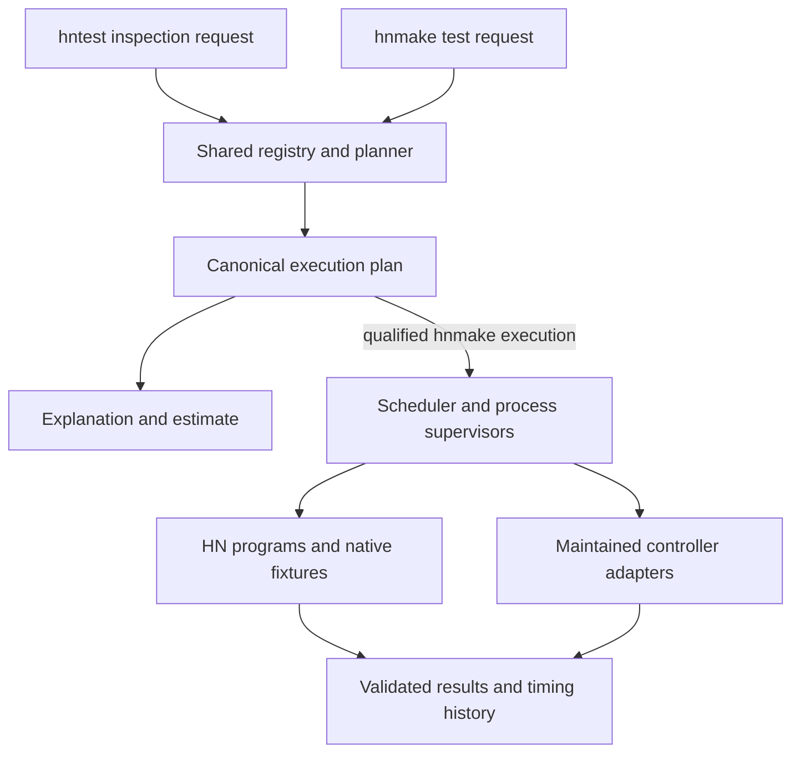

<!--
HarbourNova
Copyright 2026 Eric Lendvai (WA-USA)
SPDX-License-Identifier: GPL-3.0-or-later
-->

# Testing HarbourNova: HNTest, hnmake, and dependable results

*How I organize testing of the language and its tools, how developers can understand the results, and how the architecture can support application testing later.*

**Developer overview — November 21, 2026**

> **Scope:** For HN1, I am concentrating the testing work on HarbourNova itself: its compiler, runtime, language features, and development tools. This article explains the testing architecture, its current development interfaces, and the reasoning behind it. General application-testing integration and browser-driven regression testing are future directions. The development source remains private; repository paths identify where material belongs and are not public download links.

**Reading guide**

- [The responsibilities of HNTest, hntest, hnmake, and Cargo](#hntest-is-a-system-not-just-one-executable).
- [Choosing modes, categories, and configurations](#modes-categories-and-configurations-answer-different-questions).
- [Reusing a build when expanding the testing](#build-once-then-expand-the-testing).
- [Using multiple cores and understanding Python's role](#parallel-testing-uses-independent-processes-and-owned-resources).
- [Finding tests in the catalog](#a-central-catalog-makes-the-tests-discoverable) and [understanding local results and history](#local-history-last-attempts-and-useful-estimates).
- [Qualifying a future public code release](#qualification-before-a-public-code-release).
- [Future application, browser, and database testing](#future-application-oriented-testing).

## Why I am building a structured testing system

A programming language needs more than a collection of programs that happen to run successfully. A compiler must accept valid source, reject invalid source for the right reason, preserve language semantics, and cooperate with the runtime and native toolchain. Its build tools must select the correct inputs, invoke the correct programs, and report failures accurately.

A small change can cross several of those boundaries. An adjustment to argument handling might affect ordinary calls, named parameters, default values, methods, error reporting, and generated code. A change to numeric storage might affect arithmetic, collections, serialization, and database-related values. Testing only the most obvious example would provide limited confidence.

At the same time, repeatedly rebuilding everything and replaying every historical acceptance script after every edit would make development unnecessarily expensive. I want the testing system to identify relevant work, explain that choice, preserve required coverage, and make the result understandable.

**HNTest is the common structure for that work.** It connects an explicit inventory of tests with selection rules, execution supervision, result validation, and timing information. Its integration with `hnmake` lets the testing system use the same dependable build and process infrastructure that supports the rest of HarbourNova.

The objective is practical: a developer should be able to answer what was tested, why it was selected, which code and configuration were used, and what the result actually establishes.

## What is being tested?

For the current HN1 work, the subject is the language implementation and its development environment.

| Area | Examples of questions a test can answer |
| --- | --- |
| **Compiler and language rules** | Does valid syntax compile? Are named arguments bound correctly? Does invalid source produce the expected diagnostic? |
| **Runtime behavior** | Do values, calls, errors, ownership, and cleanup behave according to their contracts? |
| **Datatypes and APIs** | Are numeric boundaries, Text operations, Tensor storage, temporal values, and other supported behaviors correct? |
| **Native implementation** | Do C components handle their memory, input boundaries, and failure paths correctly under the selected native tools? |
| **Build and development tools** | Are inputs and dependencies resolved correctly? Are stale products rejected? Are process outcomes and diagnostics preserved? |
| **The testing infrastructure** | Does selection preserve required work? Do overlapping categories avoid duplicate dispatch? Are incomplete results kept separate from successful results? |

Some checks exercise a small function. Others compile and run an HN program or combine the compiler, runtime, linker, and build tool. A sample application can therefore be a fixture for testing HN itself without making a general application-testing framework part of the HN1 scope.

An important category is **negative testing**. A program containing an invalid declaration is useful when the expected result is a specific compiler rejection. Such a fixture passes when the required rejection is observed. An unrelated crash or arbitrary nonzero exit does not satisfy that expectation.

**Regression testing** describes the purpose of protecting established behavior against unintended change. A small function check, an integration scenario, and an expected compiler error can all be regression tests. The term does not restrict testing to unit tests.

## HNTest is a system, not just one executable

Several related names appear in the source and commands. Their responsibilities are different:

| Name | Meaning and responsibility |
| --- | --- |
| **HNTest** | The overall testing system: registry, selection, scheduling, test programs, adapters, validation, results, and history. |
| **`hntest` / `hntest.exe`** | A standalone Rust development utility for inspecting the registry, explaining selections, producing previews, and performing supported history or report operations. |
| **`hnmake test …`** | The entry point for coordinated execution of the registered HN tests. It connects the shared testing components to qualified execution adapters and process supervision. |
| **Compiled test programs** | Programs that contain the actual checks. Examples include the maintained Windows `hntest_smoke.exe` and Linux `hntest-smoke` workloads. |
| **HN compiler and runtime** | Major products being exercised by the tests. They also participate in building and running HN test programs. |
| **Cargo** | Rust's build and package manager, used when building Rust tooling such as `hnmake` and the standalone `hntest` utility from source. |

The lowercase name `hntest` is the declared Rust binary name. Windows adds the `.exe` extension. The distinction between that utility and a compiled smoke workload is their purpose and filename, not a convention that uppercase means one kind of test and lowercase means another.

### What standalone hntest does

The standalone utility provides a smaller development entry point to the shared testing components. For example:

```sh
hntest test --list-categories
hntest test --mode extended --explain
```

On Windows, the executable can be invoked as `hntest.exe`.

The first command lists categories. The second constructs and explains a selection. Neither command runs the selected HN workloads. A successful preview means that the request was understood and a plan was produced.

**The standalone utility does not currently execute the registered native test plan.** Execution belongs to the qualified `hnmake` route. Standalone generic estimate previews also begin with empty history; certain retained-report and history operations have their own explicit inputs.

This is a useful role for a development utility. It allows the selection and reporting model to be examined without treating every inspection as permission to build and run a workload.

### What hnmake adds

`hnmake` supplies the execution environment: tool and input checks, build integration, owned output locations, process supervision, and the adapters that validate particular test workloads.

**`hnmake` uses shared Rust HNTest code compiled into it. It does not need to launch the standalone `hntest.exe` to perform registered test execution.** The two entry points share the registry and selection rules, while the execution route has additional responsibilities.

A compiled test workload has another role. The smoke executable calls its compiled suites, records assertions, produces a summary, and returns an outcome. The surrounding controller also checks other evidence, including negative compiler fixtures. Running that executable alone is therefore not equivalent to completing every stage of a FULL or EXTENDED plan.

### What Cargo does, and why Rust appears here

[Cargo](https://doc.rust-lang.org/cargo/) manages Rust package dependencies and drives compilation of Rust projects. It is the standard build tool used for HarbourNova's Rust components.

The relationship is straightforward: Cargo builds the Rust tooling; the resulting `hnmake` executable coordinates HN and native builds. Developers using a packaged HN toolset use that executable directly. They do not rebuild the Rust coordinator for each HN application or test invocation.

The HN compiler itself has a C-based implementation. Cargo is not a replacement HN compiler. In the usual native build flow, the HN compiler processes `.hnp` source, and the selected native toolchain compiles and links the generated and handwritten native inputs with the required runtime components.

### Is hnmake also used to build HN itself?

Yes. Although `hnmake` supports building user applications, it also participates in the source-bootstrap workflow that prepares HarbourNova's own compiler and runtime.

That workflow follows declared dependencies: appropriate Rust and native C prerequisites are available, the build coordinator is prepared, and the required compiler and runtime stages are built in a controlled order. A freshly prepared HN compiler can then compile the HN sources needed by later toolchain components.

Building the toolchain from source and using an installed toolchain are different activities. The testing architecture keeps those activities distinguishable so that running another test selection need not imply rebuilding the compiler being tested.

## A few terms make the reports easier to read

The word “test” is often used for several different units. HNTest keeps their meanings separate.

| Term | Meaning |
| --- | --- |
| **Assertion** | One expected condition, such as a returned value, preserved input, or required error. |
| **Suite** | A group of related checks inside a test workload. |
| **Fixture** | Defined test input and setup: for example, a small HN program, a native harness, or deliberately invalid source. |
| **Runnable job** | A unit the coordinator can select and execute. It may contain one case or many suites and assertions. |
| **Configuration** | The platform, toolchain, build/runtime options, and other conditions under which a job runs. |
| **Attempt** | One actual execution of a selected job in a configuration. A retry creates another attempt. |
| **Plan** | The selected work, prerequisites, configurations, and reasons before execution. |
| **Result** | The observed outcome and evidence from an execution, tied to its inputs and context. |

For example, one integrated smoke job can build an executable containing many suites and thousands of assertions. If that job runs in two required platform configurations, those are two distinct executions. If one execution is retried, the retry is another attempt of the same logical work.

A source file is not automatically a runnable test. It may contain helper functions, several suites, or code compiled into a larger workload. A report should not inflate the unique-test count by adding categories, filenames, assertions, and retries together.

## A recognizable development cycle

Consider a change to a supported Text operation. The immediate behavioral check might verify a known input and output. Additional checks might cover NULL, Unicode, preservation of the original value, and interactions with shared runtime code.

I require the development process to identify that affected behavior and inspect the selected coverage. A typical cycle is:

1. **Understand the change.** Inspect the actual diff and the shared components it affects.
2. **Inspect the test selection.** Ask for an explanation of the relevant mode, categories, and configurations.
3. **Run the appropriate checks.** Use focused work during iteration and the required broader gate for completion or integration.
4. **Read the actual result.** Check completion, expected outcomes, source identity, and any excluded coverage.
5. **Preserve the evidence.** Keep the results and diagnostics associated with the attempt that produced them.

The command-line interface makes the selection inspectable:

```sh
hnmake test --list-categories
hnmake test --mode full --category types.text --explain
```

The examples in this article describe the development interfaces. Actual execution assumes a matching tool build, a prepared source checkout, and the prerequisites required by the selected adapters. A category listing or an explanation can be inspected without launching the selected native workloads.

This cycle applies whether a change is authored directly or with model assistance. The result must come from the defined checks and their evidence.

## One registry describes the selected work

HNTest uses an explicit, versioned registry. Each runnable unit has a stable identity, feature memberships, supported configurations, prerequisites, and an execution contract. The registry also records resource declarations and work that remains outside the new dispatch path.

Explicit registration helps answer a question that directory scanning cannot answer reliably: is this file an active test, a helper, a historical acceptance controller, or a reference example?

Feature categories form a hierarchy. Representative areas include `compiler`, `types.numeric`, `types.tensor`, `types.temporal`, `runtime.memory`, `tooling.hnmake`, and `testinfra.selection`.

A job can belong to several categories. A Tensor check containing Number values may protect both storage behavior and numeric behavior. A source change affecting either feature may therefore require that same job.

Selecting a parent category includes its descendants. Repeated `--category` arguments and comma-separated unions let a request name several areas. Unknown identities and empty selections produce diagnostics. Reserved categories describe areas that may receive coverage later; their presence does not establish an implemented feature or a runnable test.

The registry also records **migration exceptions**. Existing test families may still use their maintained runners while their registration and execution boundaries are being migrated. The new plan reports those boundaries. Required coverage does not disappear merely because a convenient new selector has not yet absorbed it.

## Modes, categories, and configurations answer different questions

Three choices are particularly important:

| Choice | Question it answers | Example |
| --- | --- | --- |
| **Mode** | How much eligible registered work should be selected within the requested scope? | FAST, SMOKE, FULL, or EXTENDED. |
| **Category** | Which feature area is being examined? | Compiler diagnostics or Tensor views. |
| **Configuration** | Under which execution conditions should the work run? | Linux/GCC optimized, a sanitizer configuration, or native Windows/MSVC64. |

An application build profile and an HNTest mode are also different concepts. Debug and optimized builds affect how code is built. FULL determines a scope of test work. The registered HNTest route uses `--configuration`; application project commands use their declared project profiles.

A **deterministic regression test** uses repeatable inputs and a defined expected result. A **sanitizer** is instrumentation added by the native toolchain to detect selected memory errors or other invalid behavior while a program runs.

### The four modes

| Mode | Selection contract | Typical purpose |
| --- | --- | --- |
| **FAST** | Uses reviewed change-impact information to narrow a deterministic candidate selection, retaining required shared contracts and prerequisites. Unknown impact causes a disclosed conservative fallback. | Repeated implementation iterations. |
| **SMOKE** | Selects applicable smoke-gate work and its required integrity checks. Without a category restriction, this selects the host's canonical registered smoke gate. | Routine regression confidence. |
| **FULL** | Selects eligible registered deterministic smoke, extended regression, and applicable conformance/integration work within the requested scope. | Significant changes and integration. |
| **EXTENDED** | Includes FULL and additional explicitly admitted workloads with defined budgets, such as supported storage and selection-scale checks. | Deliberate broader qualification and release-oriented work. |

**These are alternative selection policies, not a requirement to run four commands in succession.** They are also not a guaranteed ascending ladder of run sizes: FAST can fall back to the same deterministic selection as FULL.

A category filter still matters in FULL or EXTENDED. A FULL run restricted to one feature does not automatically claim that every unrelated feature was tested. An unfiltered release selection has a different scope from a focused development selection.

The test's primary tier is another property. A deterministic test assigned to `extended-gate` can belong to FULL. A performance-informational workload can be admitted by EXTENDED while its measured speed remains informational. Selecting EXTENDED does not create an unapproved performance threshold.

### FAST uses reviewed knowledge

The current FAST interface accepts caller-declared changed paths. For example, this is a read-only selection request for a declared Linux Tensor configuration:

```sh
hnmake test --mode fast --category types.tensor.views --configuration linux-gcc-tensor-debug --changed-path src/vm/hntensor.c --explain
```

The caller supplies the complete relevant changed-file set. Additional paths use repeated `--changed-path` options; a rename needs both the old and new path. The interface does not automatically inspect every Git change or infer every indirect dependency.

Reviewed mappings can narrow the candidate work. When a path or dependency relationship is unknown, the planner preserves the broader deterministic candidate selection and explains the fallback. FAST without useful impact information can therefore perform FULL-equivalent work within its requested scope.

I consider that visibility essential. A command named FAST should not obtain its speed by quietly omitting checks whose relevance has not been established.

## Selection is shared; execution has additional responsibilities

The registry and selection components have one Rust implementation shared by the development utility and the `hnmake` entry point. Execution connects the resulting plan to adapters that know how to build, run, and validate particular workloads.



The execution branch is entered through `hnmake`. The standalone inspection route can produce a plan without entering that branch. A future editor interface can present the same selection and results without introducing another set of test-selection rules.

An **adapter** connects a registered job to its actual workload and result contract. An HN executable, a native C fixture, and a command-line refusal test need different preparation and validation. Their adapters preserve those differences while reporting through the shared model.

An execution proceeds through defined stages: validate the request, resolve prerequisites, verify tools and inputs, reserve owned outputs, dispatch ready work, supervise the processes, validate the results, and record eligible history.

That structure matters when something fails halfway through. A completed compilation stage, a missing executable result, and a failed report publication must remain distinguishable. A generic “the command finished” message would lose information needed to understand the failure.

## Overlapping categories do not multiply the same execution

A logical execution combines a stable test identity, its fixture variant, and its declared execution context. The planner forms a union of those identities before dispatch.

For example:

```sh
hnmake test --mode full --category types.tensor,types.tensor.views,types.numeric --explain
```

If a Tensor matrix configuration matches several selected categories, it appears once with the applicable selection reasons. Choosing both a parent category and one of its children does not require a duplicate copy of the same execution.

Distinct configurations remain separate. A debug build and a sanitizer build exercise different conditions. Linux/GCC and Windows/MSVC64 supply different platform evidence. Combining their labels into one apparent pass would hide those differences.

A retry likewise remains an additional attempt of the original logical execution. It does not become another unique test.

### Some workloads remain intentionally coarse

The integrated smoke workload is currently an atomic job on each platform. Selecting one of its mapped categories can select the entire job, including suites outside the particular feature that motivated the request.

The explanation exposes both the matched members and the larger execution boundary. This is honest about the current organization: category discovery is useful even when an existing executable has not yet been divided into independently runnable cases.

Future refinements can make selections smaller where the workload boundaries support it. Such changes must preserve existing assertions and required independent proof rather than merely improve the appearance of a test count.

## Build once, then expand the testing

It is reasonable to build HN, run FAST, and later decide to run FULL against the same compiler and runtime. Selecting more tests does not inherently require rebuilding the toolchain being tested.

There are, however, three different forms of reuse:

| Reused item | What it means | Current boundary |
| --- | --- | --- |
| **HN compiler and installed runtime** | Several test selections use the same prepared toolchain. | Eligible when the relevant source, tools, runtime products, and configuration still match. |
| **Compilation work for test programs** | A test workload reuses valid generated code, compiler work, or native objects. | Some explicit reuse exists; many workloads still build fresh or need different configuration-specific artifacts. |
| **An earlier passing test result** | A broader run credits a previous result instead of executing that check again. | There is no general automatic FAST-to-FULL continuation that carries forward all prior passes. |

The first form answers the common concern: **FULL can test the same unchanged HN build already used by FAST.** The other forms are separate optimizations with their own validity conditions.

### Compiling a test program can be part of the test

A compiler test often needs to compile new input. That input may exercise a language construct, require particular generated behavior, or deliberately fail with an expected diagnostic.

This is different from recompiling the compiler itself. The existing compiler is being asked to do the work that the test is designed to examine.

Some additional coverage also requires different native artifacts. A sanitizer configuration cannot automatically reuse an ordinary optimized fixture binary and claim the same proof. Changes to a test's source or dependencies can require rebuilding that fixture while leaving the HN compiler installation unchanged.

### Reuse must be based on verified inputs

The existence of an executable with a familiar filename is not sufficient evidence that it belongs to the current test. Reuse decisions depend on the actual source, dependency, compiler, runtime, configuration, and artifact identities.

The Linux integrated smoke path has explicit reuse of eligible compiler work and an opt-in native C-object cache using existing `hnmake` build mechanisms. Required fresh work remains, including behavioral checks and parts of compilation and linking. This is a defined adapter capability, not a universal execute-only switch for every HNTest workload.

The retained application command `hnmake run --no-build --result …` is a separate operation. It should not be confused with an assumed `hnmake test --mode full --no-build` interface; the registered testing engine does not currently expose that generic flag.

I judge caching by the complete elapsed operation. Hashing, validation, process startup, native compilation, linking, and reporting all cost time. A cache is useful when the work it safely avoids exceeds the cost of finding and verifying reusable products.

Carrying successful results into a broader run would need equally explicit rules. The report would have to identify what ran freshly, what was carried forward, and why the older evidence still applies. Until that capability exists, a later FULL run can repeat work that passed in FAST.

## Parallel testing uses independent processes and owned resources

More CPU cores can help when several jobs are independent. HNTest already has bounded process-level parallelism for qualified adapters, while serial execution remains the default.

Parallel execution requires more than starting several commands. Jobs need separate writable outputs, appropriate temporary directories, clear process ownership, and scheduling that respects prerequisites and shared resources.

A test job may itself launch compiler workers. Two outer jobs can therefore consume more than two active processes. The scheduler and adapters must account for that internal work when enforcing a useful resource limit.

The current `--jobs` option accepts limits from 1 through 8, but the effective supported limit depends on the selected work. Qualified Linux Tensor parallel plans have a smaller compiler budget. Integrated Linux smoke and the combined default FULL/EXTENDED plans remain serial. The registered Windows FULL plan has qualified two-worker execution with a shared compiler slot for its compiler workloads.

Requesting more workers does not establish that an unsupported combination is safe, and it does not guarantee a proportional speedup. CPU, memory, disk activity, shared compilation, and result verification can limit the benefit.

### Python's threading model does not prevent separate test processes

Some maintained controllers still use Python. Independent operating-system processes can execute concurrently without requiring a free-threaded Python interpreter. Python's own [process-based parallelism documentation](https://docs.python.org/3/library/multiprocessing.html) explains the same distinction between separate processes and interpreter threads.

HNTest's process-level scheduling is also separate from HN's language-level threading. Running several test programs concurrently does not prove that one single-thread HN VM has acquired multi-threaded runtime semantics. Tests of Tasks, shared values, or other concurrency contracts need their own relevant implementation and qualification.

### Failure, cancellation, and retries retain their meaning

Each attempt has its own output and supervision boundary. A failure that cannot be retried stops new admissions while already admitted work can settle. Cancellation requests cancellation of active jobs and preserves whatever evidence was produced.

Retries are opt-in and bounded; the default is one attempt. A supported retry uses a fresh attempt location, revalidates its inputs, and preserves the earlier failure. A timeout, lost worker, cancellation, or invalid result is not blanket permission to keep retrying until a green result appears.

The system must also be honest about host failure. Automatic exactly-once execution cannot be promised across a crash whose final activity was not observed. An unobserved completion remains uncertain until valid evidence establishes what happened.

## What a passing result actually proves

I want a test result to be evidence about defined behavior under defined conditions. That requires more than a process exit code.

For a positive workload, the adapter checks the expected result structure and required assertions. For a negative compiler fixture, it checks the expected rejection and the diagnostic fields required by that fixture's contract. For a command-line test, the expected result may deliberately include a nonzero exit and specific output.

The result is associated with the relevant source revision or input identity, compiler/runtime products, configuration, and attempt. These facts let a later review distinguish a result for today's candidate from a result produced by different code or tools.

Several outcomes need to remain separate:

| Observation | Meaning |
| --- | --- |
| A plan was produced | Selection succeeded; no test success follows from that alone. |
| A child process exited zero | The process reported success; required result validation must still succeed. |
| Expected compiler rejection was observed | The negative fixture can pass if its complete required contract matches. |
| A job passed but outer reporting failed | The successful job evidence and failed enclosing command are both retained. |
| A run started without trustworthy completion | Completion is unknown; it is not a pass and not proof that the process is still running. |
| An older revision passed | Historical evidence exists for that revision and context. |

The distinction between a job and its enclosing command is deliberate. For example, test workloads can finish correctly and a later timing-publication step can fail. Erasing either fact would make diagnosis and future qualification less reliable.

Current registered HNTest command output is structured JSON. HN executable results and native logs provide additional workload-specific evidence. Human-readable navigation can be built on these records without changing the underlying outcomes.

Failure information is part of the history. A later successful attempt does not rewrite the earlier attempt or turn its failure into a success.

## A central catalog makes the tests discoverable

Testing infrastructure becomes more useful when the source can be found and understood. I now keep a central HNTest catalog alongside the development sources.

The catalog already exists in the development repository at these locations:

| Location | Purpose |
| --- | --- |
| `HNTest/README.md` | The entry point to the testing documentation, with a prominent catalog link. |
| `HNTest/CATALOG.md` | The main catalog: feature navigation, registered jobs, configurations, useful HN reading examples, recorded qualification, and guidance for finding local results. |
| `HNTest/CATALOG_SOURCES.md` | The detailed index of mapped source files, entry points, expected-error fixtures, native members, and declared migration paths. |

**These are repository paths, not currently accessible public links.** The source remains private while the design articles are public. When I publish the corresponding source and testing material, I intend to include the catalog in the public source tree under these locations and make it reachable from the testing documentation.

The catalog is derived from the existing registry and explicit member maps. It does not create another source of test-selection rules. It also preserves the difference between an active runnable job, a source member, a helper, and a historical or unmigrated controller.

Feature navigation can lead from a category to its registered job and then to the HN or native source that contains the checks. Where an adapter can identify internal members explicitly, those mappings are available. Dynamically produced assertions are not assigned invented stable identities merely to make a table appear complete.

### Tests can also be examples of HN

I want the test source to help developers understand the language as well as verify it. The catalog includes an inspected reading list covering topics such as:

- Named parameters and argument evaluation.
- Lazy first-non-NULL selection.
- Text trimming, Unicode behavior, and Text/Raw replacement.
- Multiple return values and discarded return positions.
- Exception control flow with TRY/CATCH/FINALLY/THROW.
- Directories and typed file writes.
- Local SQL and WorkAreas.

The reading list links to the canonical test source at its recorded revision. That preserves the relationship between a demonstrated behavior and the checks that exercise it.

Not every test file is a ready-to-copy application example. Some intentionally contain invalid source. Some require native helpers or test setup. Others contain internal compiler probes or transitional verification code around otherwise useful HN calls.

The catalog identifies that context. A positive API example, an expected-error example, a helper, and a native implementation fixture serve different purposes. A dedicated multiple-return fixture, for instance, must retain its own qualification context rather than inherit a smoke job's result merely because both contain HN code.

### The catalog is not a live dashboard

The current catalog is a source and metadata snapshot with links to recorded qualification. It cannot automatically see a newer local run on another workstation or virtual machine.

That limitation is explicit. A repository record can say which candidate passed a defined check. It should not silently become a green status for every later working copy.

The useful next presentation layer is a read-only report that combines the catalog with explicitly selected, validated run records. That is a separate reporting addition, rather than an already available catalog command.

## Local history, last attempts, and useful estimates

The execution system already produces much of the information needed for a richer results view. A run's plan identifies intended coverage. Start records identify admitted activity. Its final result records completed outcomes and evidence locations. Timing receipts preserve eligible observations with their source and execution context.

These records have different roles. A timing journal can omit an early failure that is still recorded in the run's result. A start record without a completion does not establish that a process remains alive. A complete viewer must respect those distinctions.

### Latest attempt and last success are different information

A useful report should show the **latest observed attempt** and the **last successful attempt** separately. If a test passed yesterday and failed today, yesterday's pass must not hide today's failure.

Each result also needs its platform, configuration, source identity, time, duration, and result/log location. A Windows result should not be displayed as proof of Linux behavior. An ordinary optimized result should not be displayed as a sanitizer result.

Missing selected history means “no recorded run in this history,” rather than “this test has never run anywhere.” Multiple workspaces, machines, and rotated histories can legitimately contain different observations.

I would like a future read-only report to expose those facts through search and filters, including an HN-examples view. A self-contained local HTML report could provide convenient browsing without requiring a server or a separate database. It can be generated from the shared Rust components and existing validated records.

### Estimates use comparable observations

HNTest measures elapsed time for completed attempts. Where supported, it also records phases such as setup, compiler preparation, native compilation, linking, execution, and teardown. A phase that was not measured remains unknown.

Comparable successful observations can provide sample counts, recent durations, medians, conservative estimates, and trends. Failures, timeouts, and cancelled attempts remain evidence, but do not masquerade as typical successful execution times.

The forecast considers prerequisites, worker limits, and resources that serialize otherwise independent jobs. It aims to estimate wall-clock duration, including overlap, rather than simply adding every test's duration.

For example:

```sh
hnmake test --mode full --category types.tensor --estimate
```

This is a read-only request. Without suitable comparable history, the numeric estimate is unavailable. With only a small sample, confidence remains low. Changes in tools, runtime, source inputs, cache state, or worker arrangements can make older measurements unsuitable.

A deadline is a resource limit; an estimate is an observation-based forecast. Neither is a guarantee of completion time. Competing CPU, memory, and disk activity can still change the observed duration.

### History needs its own storage discipline

Timing history is local, versioned, and bounded. Completed records are published atomically, while interrupted pending writes remain distinguishable from completed observations. Export and verification let preserved history be checked independently.

The current lifecycle supports explicit rotation to a new history location when necessary. Automatic general import, pruning, and compaction remain separate work. Native build products and raw logs live outside the timing journal, so bounding that journal does not automatically impose a global disk quota.

I want storage management to preserve accepted qualification and useful failure evidence while making ordinary development economical. That requires explicit ownership and retention rules for both caches and reports.

## New tests use the appropriate implementation language

The testing system has several layers, and one language is not the best fit for every layer.

| New work | Preferred implementation |
| --- | --- |
| HN language and public API behavior | HarbourNova `.hnp` source. |
| Native runtime, VM, memory, and compiler/runtime boundaries | C. |
| Registration, selection, scheduling, supervision, generators, validators, history, and reporting | Rust. |
| Declarative cases, configuration, and expected results | JSON or an existing canonical data format. |
| Necessary Windows host integration | PowerShell. |

**New HNTest development is Python-free by default.** I want to avoid accumulating new controllers and helpers that would immediately become another migration task.

Existing Python controllers remain where they preserve accepted coverage or directly exercise Python interoperability. They retain their documented interpreter prerequisites. Their use by selected development tests is separate from ordinary installed `hnmake` execution, whose coordinator is native Rust.

A new exception needs a concrete purpose, affected paths, runtime requirements, and a migration or retirement disposition. Bounded maintenance of an accepted controller is different from starting another general Python testing subsystem.

My priority is completing HN1 with dependable coverage, removing redundant historical execution, and improving measured build and validation costs. Complete removal of the remaining Python testing dependency is a separate optional post-Beta effort.

### Adding a test means defining its contract

A useful new test identifies the behavior being protected and an independently meaningful expected result. Registration then supplies the stable identity, feature memberships, configurations, prerequisites, and budgets needed to run it correctly.

An existing adapter should be reused when its execution and validation contract fits. A different workload may need a bounded adapter, but it should still report through the shared model.

When replacing older coverage, the migration must account for what it replaces. Several wrappers may be redundant while one unusual assertion or failure-path check remains essential. Preserving that behavior matters more than reducing the apparent number of test files.

## Test selection during model-assisted development

Because I use models extensively for development, I want the test-selection procedure to be explicit in the repository. It should remain understandable across sessions and model changes.

The development instructions in `AGENTS.md` point to the catalog, operating guide, mode architecture, and tier policy. They require inspection of the actual change, a justified selection, verification of real outcomes, and a report of what ran.

The procedure distinguishes focused iteration from feature completion and release qualification. A documentation edit needs content and link verification. A shared compiler change can require broader deterministic and platform checks. A new chat is not itself a reason to replay an accepted historical gate.

The model must also identify required coverage that remains outside registered dispatch. A missing category or adapter is a coverage question to resolve or disclose, not evidence that no testing is needed.

I expect the final work report to name the executed scope and configurations, their outcomes, result locations, and remaining limits. Confidence should be traceable to those observations.

## Qualification before a public code release

When I implement the workflow that publishes a code release from the private development repository to the public HarbourNova repository, I intend to make the broadest applicable HN qualification a condition of publication.

The highest current selection mode is EXTENDED. A release gate would use that mode for the required platforms and configurations, account for active checks still handled by separate maintained runners, and verify the actual staged release artifacts.

The intended sequence is:

1. **Identify the exact candidate.** Record the source revision and relevant toolchain, registry, and packaging inputs.
2. **Prepare the required platform builds.** Use the matching Linux/GCC and Windows/MSVC64 environments and applicable declared configurations.
3. **Run unfiltered EXTENDED coverage for the required scope.** Preserve the distinction between platform and configuration results.
4. **Account for required coverage outside the dispatcher.** Use maintained runners and explicit dispositions rather than silently omitting those checks.
5. **Verify the staged source or packages.** A source export must build with its documented prerequisites; a binary package must contain and use the intended products without accidental dependence on a private development layout.
6. **Associate publication with the passing candidate and artifact identities.** Missing or failed required checks prevent the release gate from succeeding.

EXTENDED already includes FULL's registered deterministic coverage. A release does not need four consecutive mode runs merely to pass through FAST, SMOKE, FULL, and EXTENDED.

“Maximum” means the broadest applicable, maintained release coverage under defined budgets. It does not mean unbounded stress duration or automatic replay of every historical proof. Performance measurements keep their informational status unless an explicit release policy establishes meaningful thresholds.

This publication gate is a future workflow integration. The testing components already provide useful building blocks, but selecting a mode alone does not implement a complete release pipeline. Publishing a design article is also different from publishing a compiler or runtime release.

## Future application-oriented testing

For HN1, my testing priority remains the compiler, runtime, and development tools. I also want the architecture to provide a useful foundation for application testing later.

The build system already supports a project `test_executable` target. `hnmake` can build that target, run it with declared arguments, working directory, and environment, and check expected process results. The test program supplies its behavioral assertions.

For the illustrative Orders project used in the [build toolset overview](HarbourNova_Build_Toolset_Developer_Overview.md), a project command can look like this:

```sh
hnmake test --project Orders.hnproject.json --target orders_tests --profile linux-gcc-debug
```

Those project and target names belong to the example project. This existing build-and-run foundation is distinct from exposing the full HNTest registry, category, reporting, and history model as a general application-testing product.

The two routes also have distinct options. Project testing uses its project and profile definitions. Registered HNTest selection uses modes, categories, and declared test configurations. Mixing those argument families is refused so that the intended scope remains clear.

### Tests do not have to live inside the shipped application

A developer must define the behavior to exercise and the expected outcome. That does not require adding special test entry points to the production application.

A separate test executable can have its own entry point and link the application modules it needs. It might call an invoice calculation routine with known inputs and verify the total. The application and its tests can share business logic while using different executable targets.

Other tests can interact through normal external interfaces. An API test can send requests to a server. A browser test can log in, enter data, and submit a form. Predictable test-data setup helps those scenarios, but a browser test does not inherently require a test routine inside the production program.

### Application testing can cover several levels

| Level | What it exercises | Example |
| --- | --- | --- |
| **Unit** | A small behavior in isolation. | Verify a tax calculation. |
| **Integration** | Cooperation between components. | Save an order through the persistence layer and inspect its records. |
| **End-to-end** | A user or system workflow through external interfaces. | Place an order in a browser and verify the resulting business state. |

Any of these can provide regression coverage. Future application integration would need its own registration conventions, assertion support, setup/cleanup rules, and qualification. I want to reuse explicit identities, supervised execution, and context-aware results rather than create an unrelated reporting model for each test level.

### Recorded browser scenarios and database verification

One direction I want to explore is recording a web application workflow and checking its database effects during replay.

The interface and stored result answer different questions. A page can display a success message while the application stores the wrong quantity, creates duplicate records, or changes unrelated data. Checking persistent business effects can detect defects that a page-only assertion misses.

I would evaluate an established browser automation tool for that layer. **Playwright is one candidate, not an adopted HN dependency.** Its [test generator](https://playwright.dev/docs/codegen) can turn recorded browser actions into a script and capture certain interface assertions. Its [API testing support](https://playwright.dev/docs/api-testing) can prepare server state and check server-side outcomes around browser actions. Database comparison would require additional application-specific support.

Recording would be the starting point. The developer would review the scenario and define its expected outcome before accepting it as a regression test.

A repeatable database-oriented scenario could:

1. Prepare a known initial dataset.
2. Capture the relevant database state before the scenario.
3. Replay the browser actions.
4. Wait for the relevant transactions and background work to complete.
5. Capture the resulting state.
6. Compare the observed changes with the approved expected changes.

The expected result is usually a specific change. An order scenario might require one new order, a line for two units, inventory decreasing from ten to eight, and a corresponding audit entry. It might also require unrelated records to remain unchanged.

### Comparing meaningful data

I would compare logical records and relationships rather than raw database files. Generated identifiers need rules based on stable keys or relationships. Timestamps need an explicit expectation, controlled clock, tolerance, or justified exclusion. Query results need deterministic ordering.

Those rules should be visible in the test. A comparison engine should not silently ignore differences until the output appears acceptable.

If a known-good application version supplies a reference result, the reference and candidate should begin with equivalent initial data. The recorded expectation still needs review: capturing existing behavior can also capture an existing defect.

Parallel scenarios would need isolated database state, such as separate databases, schemas, or suitably isolated datasets. Increasing the worker count must not allow one scenario to alter another's starting conditions or expected result.

### Reusing the appropriate tools

A future arrangement could let `hnmake` prepare the application, HNTest coordinate scenarios and results, a browser tool drive the interface, and application-specific checks verify persistent state.

New HN-owned orchestration and reporting should follow the Rust direction. HN remains appropriate for tests of HN application logic. An external browser tool can retain its established scripting environment; a Playwright integration could use its TypeScript runner without introducing new Python.

These are future application-testing directions. They do not expand the immediate HN1 testing objective.

## Current boundaries and continued improvement

The registered HNTest architecture has been qualified on Linux/GCC and Windows/MSVC64. Its active plans differ because the platforms have different registered adapters and proof boundaries. Qualification of that architecture does not mean every historical test family has been migrated or every imaginable HN behavior has been proved.

The current foundation includes shared selection, mode and category handling, unique execution identities, supervised adapters, validated results, timing observations, and explicit migration boundaries. The catalog makes that material easier to navigate.

Further improvements can make category selections finer, migrate additional maintained test families, reduce measured build and verification costs, broaden qualified parallel configurations, improve history management, and present results through a convenient local report or editor view.

I intend to judge those improvements by useful coverage, reliable outcomes, and actual development cost. A smaller plan is valuable when it still protects the required behavior. A faster cache is valuable when its complete operation is faster. A clearer report is valuable when it helps a developer understand both success and uncertainty.

## Source-layout references

The following development paths identify the technical authorities behind this article. They are written as paths because the source has not yet been released publicly.

| Path | Authority |
| --- | --- |
| `HNTest/registry/registry.v1.json` | Registered identities, categories, configurations, and migration dispositions. |
| `HNTest/registry/README.md` | Current commands, adapter prerequisites, selection behavior, timing, and reuse boundaries. |
| `HNTest/registry/smoke-map.v1.json` | Explicit smoke source/member mapping and negative expectations. |
| `tools/hnmake/rust/src/hntest/` | Shared testing components and qualified execution integration. |
| `docs/design/hn_test_execution_modes_categories_and_timing_2026_11_16.md` | Mode, selection, identity, and timing architecture. |
| `docs/project/HNTest_Tier_And_Reference_Test_Policy.md` | Test tiers, reference boundaries, and new-test language policy. |
| `AGENTS.md` | Required development procedure, including test selection and reporting. |

## Related reading

- [Building HarbourNova applications: hnmake, projects, and editor integration](HarbourNova_Build_Toolset_Developer_Overview.md)
- [Multiple return values](HarbourNova_Multiple_Returns_Developer_Overview.md)
- [HN1 Number data type](HarbourNova_HN1_Number_Data_Type.md)
- [HN1 Tensors](HarbourNova_Tensors_HN1_Developer_Article.md)
- [HN1 temporal data types](HarbourNova_HN1_Temporal_Data_Types_Developer_Overview.md)
- [Local SQL](HarbourNova_Local_SQL_Developer_Overview.md)
- [Post-Beta native performance direction](HarbourNova_Post_Beta_Native_Performance_Developer_Overview.md)
- [Browse the public design articles](.)
- [HarbourNova users community](https://groups.google.com/g/harbournova-users)
